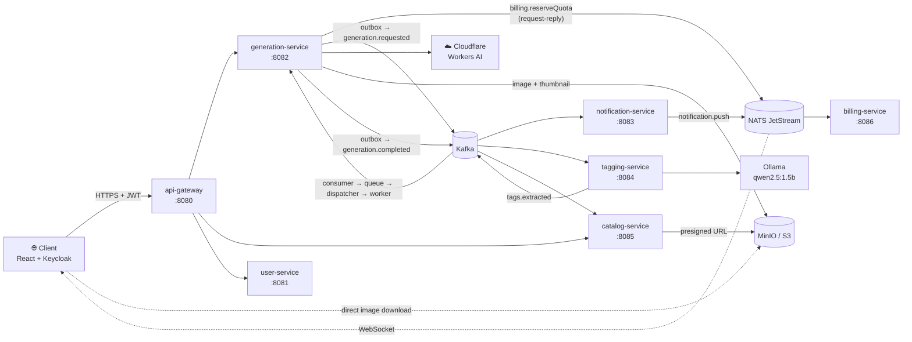

<div align="right">

[Русский](README.md) · English

</div>

# 🎨 AI Image Gallery

> A web platform for generating images from text prompts: microservices, Kafka, outbox, quota reservations, WebSocket and full observability.


<p align="center">
  
</p>

---

## 📖 Table of Contents

- [About](#-about)
- [Features](#-features)
- [Architecture](#️-architecture)
- [Single Generation Pipeline](#-single-generation-pipeline)
- [Tech Stack](#️-tech-stack)
- [Getting Started](#-getting-started)
- [Ports](#-ports)
- [Key Technical Decisions](#-key-technical-decisions)
- [Screenshots](#-screenshots)
- [Project Structure](#-project-structure)
- [License](#-license)

---

## 🎯 About

**AI Image Gallery** is a web platform for generating images from text prompts, with history, tagging, a public feed, recommendations and a quota system. It is a portfolio pet project built with a production mindset: microservices, event-driven architecture, observability and integration tests with Testcontainers.

**The main idea: image quality is secondary.** The AI provider is a replaceable "black box" behind the `ImageProvider` interface. The real value of the project is the system around it: Kafka, outbox, idempotency, retry, circuit breaker, queue prioritization, WebSocket, quotas with reservation, presigned URLs and an event-driven read model.

The project consists of **7 backend services** and a React frontend. Each service owns its own database (database-per-service) and communicates via Kafka (events), NATS (request-reply and pub/sub) and REST through the gateway.

Three AI providers are supported: **Cloudflare Workers AI** (primary, model `@cf/black-forest-labs/flux-1-schnell`, free tier of 10,000 Neurons per day — roughly 50–500 images), **HuggingFace Inference API** (optional fallback) and **MockProvider** (for tests, images kept in memory).

---

## ✨ Features

- 🖼️ **Generation** of images from text prompts with real-time status updates (WebSocket)
- 🕘 **History** of the user's recent generations
- 📰 **Feed** of all public images with cursor pagination
- 🏷️ **Automatic tagging** — tags are extracted from the prompt by a local LLM (Ollama) or by a keyword dictionary
- 🔎 **Search** and browsing images by tag
- 🎯 **Recommendations** based on the tags of the user's own generations
- 💳 **Quotas**: FREE plan (10/day) and PRO plan (100/day), reservation with refund on failure
- 👤 **Profile** with plan, remaining quota and account deletion
- 🔐 **Authentication** via Keycloak (OIDC, PKCE), roles and JWT
- 📊 **Observability**: metrics, logs and end-to-end traces across the whole pipeline

---

## 🏗️ Architecture



### Services

| Service | Port | Responsibility |
|---|---|---|
| **api-gateway** | 8080 | The only external entry point. Validates JWT, strips client-supplied `X-User-*` headers, sets its own (`X-User-Id`, `X-User-Roles`, `X-User-Name`, `X-Request-Id`, `X-Trace-Id`), per-user rate limiting via Redis, circuit breaker, CORS |
| **user-service** | 8081 | User profiles, lazy creation on first request, account deletion via outbox (async worker + Keycloak Admin API), publishes `user.created` / `user.deleted` |
| **generation-service** | 8082 | System core: job intake, quota reservation, outbox, priority queue, dispatcher, worker, providers, retry, circuit breaker, bulkhead |
| **notification-service** | 8083 | Consumes Kafka, publishes to NATS, holds WebSocket sessions at `/ws/generations/{id}`, sends initial state, heartbeat every 20 s |
| **tagging-service** | 8084 | Extracts tags from the prompt via Ollama (fallback: keyword matching against an alias dictionary), stores weighted tags, publishes `tags.extracted` |
| **catalog-service** | 8085 | Event-driven read model: feed, search, tags, recommendations, presigned URLs, cursor pagination, Redis cache |
| **billing-service** | 8086 | Quotas over NATS request-reply: reservation (15 min TTL), confirmation, refund; FREE / PRO plans |

### Key services in detail

**generation-service** accepts `POST /generations`, reserves quota via NATS (`billing.reserveQuota`) and writes the job and an outbox event in a single transaction. The chain then continues: *outbox publisher → Kafka → consumer → priority queue → dispatcher → worker → ImageProvider → MinIO → `generation.completed`*. Provider calls are serialized with `Semaphore(1)`, retries go through the `retry_queue` table and a `@Scheduled RetryScheduler`, and an offset tracker with a contiguous prefix provides at-least-once delivery.

**catalog-service** never generates anything itself. It consumes `generation.completed` (creates `catalog_images`), `tags.extracted` (creates `catalog_image_tags`) and `user.created` / `user.deleted` (manages authors). REST API:

```text
GET /api/v1/feed
GET /api/v1/images/{id}
GET /api/v1/tags
GET /api/v1/tags/{tag}/images
GET /api/v1/search
GET /api/v1/users/{id}/generations
GET /api/v1/recommendations
```

**billing-service** uses Redis `INCR` as a fast counter and Postgres as the source of truth. A `@Scheduled` job releases expired reservations.

---

## 🔄 Single Generation Pipeline

1. The user types a prompt in the browser and clicks "Generate".
2. The **gateway** validates the JWT, applies per-user rate limiting and routes the request to generation-service.
3. **generation-service**: idempotency check (Redis + unique index), quota reservation via NATS `billing.reserveQuota` (15 min TTL), `INSERT generations (status=QUEUED)` + `INSERT outbox` in one transaction. Responds with `202` and a `jobId`.
4. The **outbox publisher** (500 ms polling) publishes `generation.requested.free` to Kafka.
5. The **consumer** reads the message and puts it into the `BoundedTierQueue` (PRO has priority over FREE, slot reservation 20/10 out of 30).
6. The **dispatcher** takes a job from the queue and hands it to a worker.
7. The **worker** calls `ImageProvider` (Cloudflare Workers AI with `Semaphore(1)` and a 5 s minimum interval between requests). The image is downloaded, a thumbnail is cut, and both are uploaded to MinIO.
8. The worker, in one transaction: `status=COMPLETED` + `INSERT outbox (generation.completed)`.
9. The outbox publishes `generation.completed` to Kafka.
10. Three consumer groups read the event concurrently:
    - **notification-service** → NATS `notification.push` → WebSocket to the client
    - **tagging-service** → Ollama → `tags.extracted` to Kafka
    - **catalog-service** → `catalog_images` in the read model
11. **catalog-service** appends tags on `tags.extracted`.
12. The browser receives the event over WebSocket and displays the image via a presigned URL.

---

## 🛠️ Tech Stack

| Area | Technologies |
|---|---|
| **Backend** | Java 21, Spring Boot 3.4.1, Spring Cloud 2024.0.1, Maven multi-module |
| **Web** | Spring Cloud Gateway (WebFlux) for the gateway; Spring MVC + JPA for the other services |
| **Messaging** | Spring Kafka (KRaft, no ZooKeeper), NATS JetStream (`jnats`) |
| **Data** | PostgreSQL 16 (database-per-service), Redis 7, Flyway |
| **Storage** | MinIO (S3-compatible), MinIO SDK |
| **Resilience** | Resilience4j (programmatic, not annotations) |
| **Utilities** | MapStruct, Lombok |
| **Security** | Keycloak 26 (OIDC, JWT, roles) |
| **Observability** | Micrometer + OpenTelemetry, Prometheus, Grafana, Loki, Tempo |
| **AI** | Cloudflare Workers AI (flux-1-schnell), HuggingFace (fallback), Ollama + `qwen2.5:1.5b` for tagging |
| **Frontend** | React 18, TypeScript, Vite, React Router v6, `keycloak-js` (OIDC PKCE), native WebSocket, plain CSS |
| **Testing** | JUnit, Testcontainers (Postgres, Kafka, Redis, NATS, MinIO), k6 |
| **Infrastructure** | Docker Compose with `core` / `observability` / `ai` profiles |

**Databases** (one per service): `users_db`, `generations_db`, `tags_db`, `catalog_db`, `billing_db`, `keycloak`.

---

## 🚀 Getting Started

### Requirements

- Docker Desktop
- Java 21
- Maven
- Node.js 20+ (for the dev frontend)

### 1. Environment variables

For Cloudflare Workers AI, create a `.env` file in the repository root (template: `infra/.env.example`):

```env
CLOUDFLARE_ACCOUNT_ID=...
CLOUDFLARE_API_TOKEN=...
```

### 2. Infrastructure

Postgres, Kafka, Redis, NATS, MinIO, Keycloak:

```bash
cd infra
docker compose --profile core up -d
```

Optional profiles:

```bash
docker compose --profile observability up -d   # Prometheus, Grafana, Loki, Tempo
docker compose --profile ai up -d              # Ollama (qwen2.5:1.5b)
```

### 3. Backend

Run each service in its own terminal window:

```bash
mvn -pl api-gateway spring-boot:run
mvn -pl user-service spring-boot:run
mvn -pl generation-service spring-boot:run -Dspring-boot.run.profiles=demo,demo-local
mvn -pl notification-service spring-boot:run
mvn -pl tagging-service spring-boot:run
mvn -pl catalog-service spring-boot:run
mvn -pl billing-service spring-boot:run -Dspring-boot.run.profiles=dev
```

### 4. Frontend

```bash
cd frontend
npm install
npm run dev
```

### 5. Done

Open http://localhost:5173, log in (username `user`, password `picturesAI`) and generate an image.

### Tests

```bash
mvn test                  # unit + integration (Docker must be running for Testcontainers)
```

Load tests live in `load-test/` (k6): a 10-virtual-user scenario and a 50-VU throughput scenario.

---

## 🔌 Ports

| Component | Port |
|---|---|
| Frontend (dev) | 5173 |
| api-gateway | 8080 |
| user-service | 8081 |
| generation-service | 8082 |
| notification-service | 8083 |
| tagging-service | 8084 |
| catalog-service | 8085 |
| billing-service | 8086 |
| Keycloak | 8090 |
| PostgreSQL | 5433 |
| Kafka | 29092 |
| NATS | 4222 |
| MinIO S3 / UI | 9000 / 9001 |
| Prometheus | 9090 |
| Grafana | 3000 |
| Loki | 3100 |
| Tempo | 3200 |

---

## 💡 Key Technical Decisions

- **Outbox pattern.** DB + Kafka atomicity: a transaction writes the job and the event, and a separate publisher sends it to Kafka with at-least-once delivery.
- **Three-level idempotency.** Redis `SETNX` + a unique DB index + response caching: a repeated `POST` with the same `Idempotency-Key` returns the same `jobId`.
- **Offset tracker with a contiguous prefix.** Workers finish out of order, so `min(unfinished offset)` is committed, preserving at-least-once.
- **Priority queue with slot reservation.** PRO takes priority but never starves FREE (20/10 slots out of 30).
- **Quotas via reservation with TTL.** If a generation fails, the user doesn't lose quota: it is refunded on `FAILED` / `CANCELLED` or released when the TTL expires.
- **Presigned URLs.** The browser downloads images straight from MinIO; the backend doesn't proxy traffic.
- **Event-driven read model (CQRS-lite).** catalog-service doesn't create images itself, it only reads Kafka.
- **WebSocket + initial state.** On connecting to an already finished generation, the client immediately gets the final status instead of waiting for an event.
- **Heartbeat.** A ping every 20 seconds keeps connections alive.
- **Tagging with a local LLM.** Ollama (1.5B parameters) with a keyword-matching fallback over an alias dictionary.
- **Recommendations.** Weighted tag overlap between the user's tags and other users' images, sorted by number of matches.
- **Programmatic Resilience4j.** The chain `RateLimiter → CircuitBreaker → Retry → Bulkhead → HTTP`.
- **End-to-end observability.** `traceId` travels through HTTP, Kafka and NATS; a single trace covers the whole pipeline in Grafana Tempo.
- **Serialized provider calls.** `Semaphore(1)` plus a 5 s minimum interval keeps usage within Cloudflare's free limits.

---

## 📸 Screenshots

### Generation history

<p align="center">
  
</p>

### Profile: FREE plan, quota 8/10, PRO button

<p align="center">
  
</p>

### Tag-based recommendations

<p align="center">
  
</p>

---

## 📁 Project Structure

```text
picturesAI/
├── api-gateway/          — Spring Cloud Gateway
├── user-service/         — profiles
├── generation-service/   — core (Kafka, dispatcher, providers)
├── notification-service/ — WebSocket
├── tagging-service/      — LLM tagging
├── catalog-service/      — read model, feed, recommendations
├── billing-service/      — quotas
├── frontend/             — React
├── infra/                — docker-compose, infra configs, .env.example
├── load-test/            — k6 scripts
├── screenshots/          — README screenshots
├── pom.xml               — root Maven parent
└── README.md
```

---

## 📄 License

This project is licensed under the [MIT](LICENSE) license.