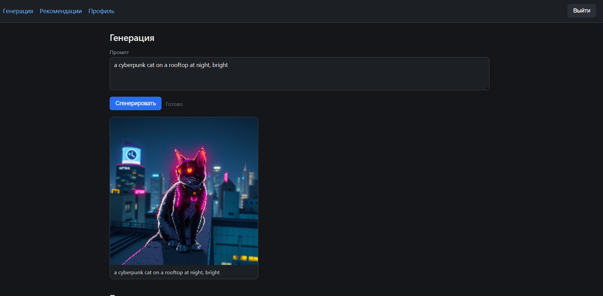
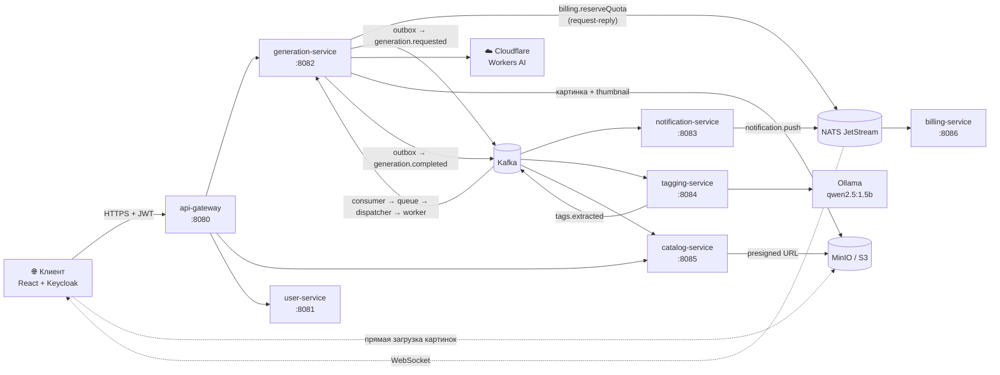
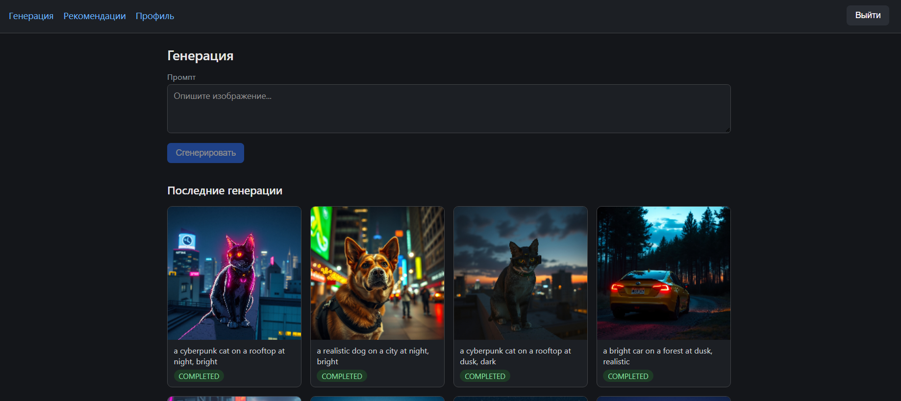
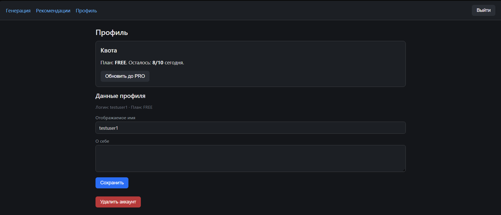
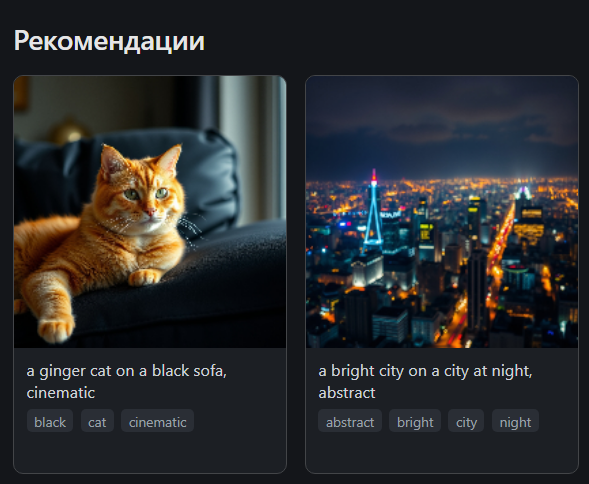

<div align="right">

Русский · [English](README.en.md)

</div>

# 🎨 AI Image Gallery

> Веб-платформа генерации изображений по текстовым промптам: микросервисы, Kafka, outbox, квоты с резервацией, WebSocket и полная observability.


<p align="center">
  
</p>

---

## 📖 Оглавление

- [О проекте](#-о-проекте)
- [Возможности](#-возможности)
- [Архитектура](#️-архитектура)
- [Пайплайн одной генерации](#-пайплайн-одной-генерации)
- [Стек](#️-стек)
- [Как запустить](#-как-запустить)
- [Порты](#-порты)
- [Ключевые технические решения](#-ключевые-технические-решения)
- [Скриншоты](#-скриншоты)
- [Структура проекта](#-структура-проекта)
- [Лицензия](#-лицензия)

---

## 🎯 О проекте

**AI Image Gallery** — веб-платформа для генерации изображений по текстовым промптам с историей, тегированием, лентой, рекомендациями и системой квот. Это pet-проект для портфолио, сделанный с production-подходом: микросервисы, event-driven архитектура, observability и интеграционные тесты на Testcontainers.

**Главная идея: качество картинок вторично.** AI-провайдер здесь — заменяемый «чёрный ящик» за интерфейсом `ImageProvider`. Ценность проекта — в системе вокруг него: Kafka, outbox, идемпотентность, retry, circuit breaker, приоритизация очереди, WebSocket, квоты с резервацией, presigned URL и read-model через события.

Проект состоит из **7 backend-сервисов** и React-фронтенда. Каждый сервис владеет собственной базой данных (database-per-service), а общение между ними идёт через Kafka (события), NATS (request-reply и pub/sub) и REST через gateway.

Поддерживаются три AI-провайдера: **Cloudflare Workers AI** (основной, модель `@cf/black-forest-labs/flux-1-schnell`, бесплатный лимит 10 000 Neurons в день — примерно 50–500 картинок), **HuggingFace Inference API** (опциональный резерв) и **MockProvider** (для тестов, картинки в памяти).

---

## ✨ Возможности

- 🖼️ **Генерация** изображений по текстовому промпту со статусами в реальном времени (WebSocket)
- 🕘 **История** последних генераций пользователя
- 📰 **Лента** всех публичных изображений с cursor-пагинацией
- 🏷️ **Автоматические теги** — извлекаются из промпта локальной LLM (Ollama) или по словарю
- 🔎 **Поиск** и просмотр картинок по тегам
- 🎯 **Рекомендации** на основе тегов собственных генераций пользователя
- 💳 **Квоты**: план FREE (10 в день) и PRO (100 в день), резервация с возвратом при ошибке
- 👤 **Профиль** с планом, остатком квоты и удалением аккаунта
- 🔐 **Авторизация** через Keycloak (OIDC, PKCE), роли и JWT
- 📊 **Observability**: метрики, логи и сквозные трейсы по всему пайплайну

---

## 🏗️ Архитектура



### Сервисы

| Сервис | Порт | Ответственность |
|---|---|---|
| **api-gateway** | 8080 | Единственная точка входа. Валидация JWT, удаление клиентских `X-User-*`, проставление своих заголовков (`X-User-Id`, `X-User-Roles`, `X-User-Name`, `X-Request-Id`, `X-Trace-Id`), rate limit per-user через Redis, circuit breaker, CORS |
| **user-service** | 8081 | Профили, lazy creation при первом запросе, удаление аккаунта через outbox (async worker + Keycloak Admin API), публикует `user.created` / `user.deleted` |
| **generation-service** | 8082 | Ядро системы: приём задач, резервация квоты, outbox, приоритетная очередь, dispatcher, worker, провайдеры, retry, circuit breaker, bulkhead |
| **notification-service** | 8083 | Читает Kafka, публикует в NATS, держит WebSocket-сессии `/ws/generations/{id}`, отдаёт initial state, heartbeat каждые 20 сек |
| **tagging-service** | 8084 | Извлекает теги из промпта через Ollama (fallback — keyword matching по словарю aliases), сохраняет теги с весами, публикует `tags.extracted` |
| **catalog-service** | 8085 | Read-model через события: лента, поиск, теги, рекомендации, presigned URL, cursor-пагинация, Redis-кэш |
| **billing-service** | 8086 | Квоты через NATS request-reply: резервация (TTL 15 мин), подтверждение, возврат; планы FREE / PRO |

### Подробнее о ключевых сервисах

**generation-service** принимает `POST /generations`, резервирует квоту через NATS (`billing.reserveQuota`) и в одной транзакции пишет задачу в свою БД и событие в outbox. Дальше цепочка: *outbox-publisher → Kafka → consumer → приоритетная очередь → dispatcher → worker → ImageProvider → MinIO → `generation.completed`*. Вызовы провайдера сериализуются через `Semaphore(1)`, повторные попытки идут через таблицу `retry_queue` и `@Scheduled RetryScheduler`, а offset tracker с непрерывным префиксом обеспечивает at-least-once.

**catalog-service** сам ничего не генерирует. Он читает `generation.completed` (создаёт `catalog_images`), `tags.extracted` (создаёт `catalog_image_tags`) и `user.created` / `user.deleted` (управляет авторами). REST API:

```text
GET /api/v1/feed
GET /api/v1/images/{id}
GET /api/v1/tags
GET /api/v1/tags/{tag}/images
GET /api/v1/search
GET /api/v1/users/{id}/generations
GET /api/v1/recommendations
```

**billing-service** использует Redis `INCR` как быстрый счётчик и Postgres как источник истины. Просроченные резервации освобождает `@Scheduled`-задача.

---

## 🔄 Пайплайн одной генерации

1. Пользователь пишет промпт в браузере и жмёт «Сгенерировать».
2. **Gateway** валидирует JWT, применяет rate limit per-user и роутит запрос в generation-service.
3. **generation-service**: проверка идемпотентности (Redis + unique index), резервация квоты через NATS `billing.reserveQuota` (TTL 15 мин), `INSERT generations (status=QUEUED)` + `INSERT outbox` в одной транзакции. Ответ `202` с `jobId`.
4. **Outbox publisher** (polling 500 мс) публикует `generation.requested.free` в Kafka.
5. **Consumer** читает сообщение и кладёт в `BoundedTierQueue` (PRO приоритетнее FREE, slot reservation 20/10 из 30).
6. **Dispatcher** берёт задачу из очереди и отправляет воркеру.
7. **Worker** вызывает `ImageProvider` (Cloudflare Workers AI с `Semaphore(1)` и минимальным интервалом 5 сек между запросами). Картинка скачивается, режется thumbnail, всё заливается в MinIO.
8. Worker в одной транзакции: `status=COMPLETED` + `INSERT outbox (generation.completed)`.
9. Outbox публикует `generation.completed` в Kafka.
10. Три consumer-группы читают событие одновременно:
    - **notification-service** → NATS `notification.push` → WebSocket клиенту
    - **tagging-service** → Ollama → `tags.extracted` в Kafka
    - **catalog-service** → `catalog_images` в read-model
11. **catalog-service** на `tags.extracted` дописывает теги.
12. Браузер получает событие по WebSocket и показывает картинку по presigned URL.

---

## 🛠️ Стек

| Область | Технологии |
|---|---|
| **Backend** | Java 21, Spring Boot 3.4.1, Spring Cloud 2024.0.1, Maven multi-module |
| **Web** | Spring Cloud Gateway (WebFlux) для gateway; Spring MVC + JPA для остальных сервисов |
| **Messaging** | Spring Kafka (KRaft, без ZooKeeper), NATS JetStream (`jnats`) |
| **Данные** | PostgreSQL 16 (database-per-service), Redis 7, Flyway |
| **Хранилище** | MinIO (S3-совместимое), MinIO SDK |
| **Надёжность** | Resilience4j (программно, не аннотациями) |
| **Утилиты** | MapStruct, Lombok |
| **Безопасность** | Keycloak 26 (OIDC, JWT, роли) |
| **Observability** | Micrometer + OpenTelemetry, Prometheus, Grafana, Loki, Tempo |
| **AI** | Cloudflare Workers AI (flux-1-schnell), HuggingFace (резерв), Ollama + `qwen2.5:1.5b` для тегирования |
| **Frontend** | React 18, TypeScript, Vite, React Router v6, `keycloak-js` (OIDC PKCE), native WebSocket, plain CSS |
| **Тесты** | JUnit, Testcontainers (Postgres, Kafka, Redis, NATS, MinIO), k6 |
| **Инфраструктура** | Docker Compose с профилями `core` / `observability` / `ai` |

**Базы данных** (по одной на сервис): `users_db`, `generations_db`, `tags_db`, `catalog_db`, `billing_db`, `keycloak`.

---

## 🚀 Как запустить

### Требования

- Docker Desktop
- Java 21
- Maven
- Node.js 20+ (для dev-фронтенда)

### 1. Переменные окружения

Для Cloudflare Workers AI создайте `.env` в корне репозитория (шаблон — `infra/.env.example`):

```env
CLOUDFLARE_ACCOUNT_ID=...
CLOUDFLARE_API_TOKEN=...
```

### 2. Инфраструктура

Postgres, Kafka, Redis, NATS, MinIO, Keycloak:

```bash
cd infra
docker compose --profile core up -d
```

Дополнительные профили:

```bash
docker compose --profile observability up -d   # Prometheus, Grafana, Loki, Tempo
docker compose --profile ai up -d              # Ollama (qwen2.5:1.5b)
```

### 3. Backend

Каждый сервис — в отдельном окне терминала:

```bash
mvn -pl api-gateway spring-boot:run
mvn -pl user-service spring-boot:run
mvn -pl generation-service spring-boot:run -Dspring-boot.run.profiles=demo,demo-local
mvn -pl notification-service spring-boot:run
mvn -pl tagging-service spring-boot:run
mvn -pl catalog-service spring-boot:run
mvn -pl billing-service spring-boot:run -Dspring-boot.run.profiles=dev
```

### 4. Frontend

```bash
cd frontend
npm install
npm run dev
```

### 5. Готово

Откройте http://localhost:5173, войдите (логин `user`, пароль `picturesAI`) и сгенерируйте картинку.

### Тесты

```bash
mvn test                  # unit + интеграционные (нужен запущенный Docker для Testcontainers)
```

Load-тесты лежат в `load-test/` (k6): сценарий на 10 виртуальных пользователей и throughput-сценарий на 50 VU.

---

## 🔌 Порты

| Компонент | Порт |
|---|---|
| Frontend (dev) | 5173 |
| api-gateway | 8080 |
| user-service | 8081 |
| generation-service | 8082 |
| notification-service | 8083 |
| tagging-service | 8084 |
| catalog-service | 8085 |
| billing-service | 8086 |
| Keycloak | 8090 |
| PostgreSQL | 5433 |
| Kafka | 29092 |
| NATS | 4222 |
| MinIO S3 / UI | 9000 / 9001 |
| Prometheus | 9090 |
| Grafana | 3000 |
| Loki | 3100 |
| Tempo | 3200 |

---

## 💡 Ключевые технические решения

- **Outbox-паттерн.** Атомарность БД + Kafka: транзакция пишет задачу и событие, отдельный publisher шлёт его в Kafka с гарантией at-least-once.
- **Идемпотентность на трёх уровнях.** Redis `SETNX` + unique index в БД + response caching: повторный `POST` с тем же `Idempotency-Key` возвращает тот же `jobId`.
- **Offset tracker с непрерывным префиксом.** Воркеры завершаются не по порядку, поэтому коммитится `min(незавершённый offset)` — это сохраняет at-least-once.
- **Приоритетная очередь со slot reservation.** PRO имеет приоритет, но не блокирует FREE навсегда (20/10 слотов из 30).
- **Квоты через резервацию с TTL.** Если генерация упала, пользователь не теряет квоту: она возвращается при `FAILED` / `CANCELLED` или освобождается по истечении TTL.
- **Presigned URL.** Браузер скачивает картинки напрямую из MinIO, бэкенд не проксирует трафик.
- **Read-model через события (CQRS-lite).** catalog-service не создаёт картинки сам, а только читает Kafka.
- **WebSocket + initial state.** При подключении к уже завершённой генерации клиент сразу получает финальный статус и не ждёт события.
- **Heartbeat.** Ping каждые 20 секунд, чтобы соединение не рвалось.
- **Тегирование через локальную LLM.** Ollama (1.5B параметров) с fallback на keyword matching по словарю aliases.
- **Рекомендации.** Взвешенное пересечение тегов пользователя с чужими картинками, сортировка по числу совпадений.
- **Resilience4j программно.** Цепочка `RateLimiter → CircuitBreaker → Retry → Bulkhead → HTTP`.
- **Сквозная observability.** `traceId` проходит через HTTP, Kafka и NATS; один trace виден во всём пайплайне в Grafana Tempo.
- **Сериализация вызовов провайдера.** `Semaphore(1)` + минимальный интервал 5 сек — укладываемся в бесплатные лимиты Cloudflare.

---

## 📸 Скриншоты

### История генераций

<p align="center">
  
</p>

### Профиль: план FREE, квота 8/10, кнопка PRO

<p align="center">
  
</p>

### Рекомендации по тегам

<p align="center">
  
</p>

---

## 📁 Структура проекта

```text
picturesAI/
├── api-gateway/          — Spring Cloud Gateway
├── user-service/         — профили
├── generation-service/   — ядро (Kafka, dispatcher, провайдеры)
├── notification-service/ — WebSocket
├── tagging-service/      — LLM-тегирование
├── catalog-service/      — read-model, лента, рекомендации
├── billing-service/      — квоты
├── frontend/             — React
├── infra/                — docker-compose, конфиги инфраструктуры, .env.example
├── load-test/            — k6 скрипты
├── screenshots/          — скриншоты для README
├── pom.xml               — корневой Maven parent
└── README.md
```

---

## 📄 Лицензия

Проект распространяется по лицензии [MIT](LICENSE).